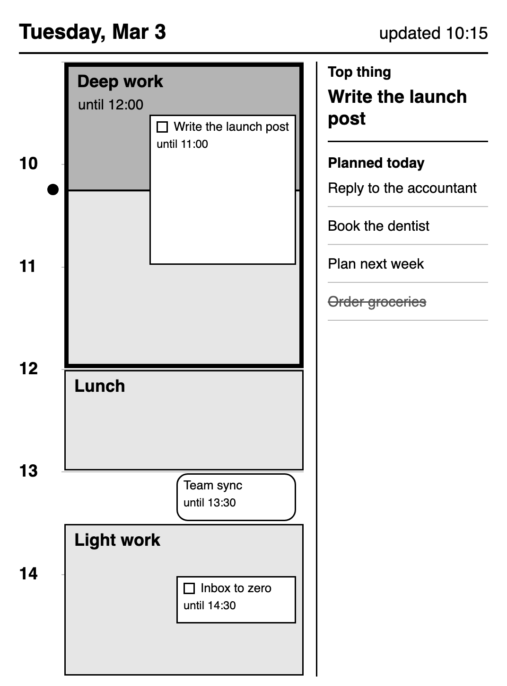

# Superfocus on a Kindle

Your day from Superfocus on an old Kindle: the block you are in, what comes next, your top thing and the tasks planned for today. The screen refreshes every 15 minutes.



## How it works

1. A small program on a computer at home asks the Superfocus API for your day and draws it as a picture, once a minute.
2. A script on the Kindle downloads that picture over Wi-Fi every 15 minutes and paints it on the screen.

Your API key stays on the computer. The Kindle only ever sees the picture.

## Read this first

- **The Kindle must be jailbroken.** Amazon does not support this. A failed jailbreak can mean a factory reset, which removes the books stored on the device (books in your Amazon account can be downloaded again). Use a Kindle you can live without.
- **This is a community example, shared as is.** There is no support for it. Questions about jailbreaking belong with the [Kindle modding community](https://kindlemodding.org).
- **Tested on one Kindle so far:** a Paperwhite 10th generation, firmware 5.18.1.1.1. It should work on other Kindles with the same 1072 x 1448 screen, such as the Paperwhite 3 (7th generation, 2015), which gets the same tools from its jailbreak. Nobody has run the script on those yet, so expect to adjust a thing or two, with Claude's help. If you get it running on another model, tell us what you changed.
- **It lives on a charger.** The screen and light stay on, which uses roughly 10% of the battery every 3 hours.
- **The computer must stay on** and be on the same Wi-Fi as the Kindle.
- **Anyone on your home network can open the picture** if they know the address. Do not run this on a shared or public network.

## What you need

- A Superfocus subscription and an API key (free to create, read-only is enough)
- A computer that stays on at home: Mac, Windows, Linux or a Raspberry Pi
- [Node.js](https://nodejs.org) version 22 or newer, and Google Chrome or Chromium, on that computer
- A Kindle with a 6 inch, 1072 x 1448 screen, and its USB cable
- An evening. Most of it is the jailbreak

## The easy way: do it with Claude

Open this folder in Claude Code, or start a chat in the Claude app and attach `CLAUDE.md` from this folder. Then say:

> Help me set up Superfocus on my Kindle.

Claude walks you through the steps below one at a time, checks each one worked and adapts to your Kindle's firmware.

## The steps

### 1. See it work on your computer first

No Kindle and no key needed for this one. In a terminal, inside this folder:

```bash
npm run sample
```

Open `http://localhost:8787/screen.png` in your browser after a few seconds. You should see the sample day from the picture above. Stop the program with Ctrl+C.

### 2. Connect your own schedule

1. In Superfocus, open Toolkit, then Integrations, then API, and create a key. Leave "Can edit" off. The key is shown once.
2. Copy the file `.env.example` to a new file named `.env`.
3. Open `.env` and replace `sfk_paste_your_key_here` with your key.
4. Start the program:

```bash
npm start
```

Reload `http://localhost:8787/screen.png`. It now shows your own day. Leave the program running.

### 3. Jailbreak the Kindle

Follow the Kindle modding community's own guide, word for word. Do not follow jailbreak steps written by an AI, including Claude: the maintainers warn against it, and the steps change.

1. On the Kindle, open Settings, then Device Options, then Device Info. Write down the firmware version and the serial number.
2. Enter them in the [Jailbreak Wizard](https://kindlemodding.org/jailbreak-wizard.html). It tells you which method fits your Kindle.
3. Follow the page the wizard gives you from top to bottom, including its "what's next" step. The method depends on your model and firmware: for a Paperwhite 3, for example, the wizard's data points to [WinterBreak2](https://kindlemodding.org/jailbreaking/WinterBreak2/).

After a current jailbreak there is nothing else to install. It sets up what this project uses: scripts you can start from the Kindle library, and a tool named FBInk that paints pictures on the screen.

### 4. Put the script on the Kindle

1. Find your computer's address on your home network. It looks like `192.168.1.23`. Claude can find it for you.
2. Open `kindle/superfocus.sh` in a plain text editor. Change the line `SERVER=http://CHANGE-ME:8787` so it holds your computer's address, for example `SERVER=http://192.168.1.23:8787`. Save.
3. Connect the Kindle with its USB cable. Copy `superfocus.sh` into the Kindle's `documents` folder. Eject the Kindle.
4. In the Kindle library, tap the new item named **Superfocus**.

After a few seconds your day fills the screen.

### 5. Stop it and read again

Touch the screen anywhere. The Kindle goes back to normal within a few seconds. Tap **Superfocus** in the library to start it again.

If the Kindle ever seems stuck, restart it by holding the power button until it reboots. A restart always brings back the normal Kindle; nothing this script does survives one.

## If something goes wrong

| What you see | What to check |
|---|---|
| "set SERVER in superfocus.sh first" | Step 4.2 was skipped |
| "no answer from ..." on the Kindle | The program is not running, the address is wrong, or the computer's firewall blocks port 8787 |
| "No data" and an error on the picture | The API key in `.env` is wrong or the subscription is not active |
| "Superfocus" opens as a text file | The jailbreak did not finish; go back to the guide in step 3 |
| The normal Kindle screen comes back by itself | Start it again and tell Claude; the script keeps a log on the Kindle at `superfocus/log.txt` |

## Change how it looks

`index.html` is the whole page. Open `http://localhost:8787/` in a browser while the program runs to see it, and add `?now=14:30` to the address to preview another time of day. Times use the 24 hour clock.

The API offers more than this page shows. The full list is at `https://api.superfocus.me/v1/openapi.json`.

## Files

| File | What it is |
|---|---|
| `server.js` | The program for the computer. Fetches your day and draws the picture |
| `index.html` | The page that becomes the picture |
| `kindle/superfocus.sh` | The script for the Kindle |
| `.env.example` | Template for your settings |
| `sample/day.json` | A made-up day for trying it without a key |
| `CLAUDE.md` | Instructions for Claude, so it can guide you |

## Licence

MIT. See `LICENSE`.
